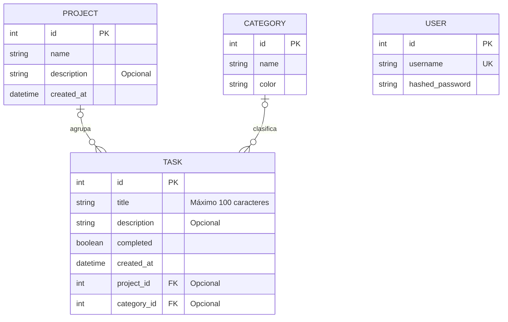

# Práctica 1.5 — Modelos SQLAlchemy y conexión a base de datos

## Objetivo

En esta práctica se incorpora persistencia a TaskFlow mediante **SQLAlchemy y SQLite**. Los proyectos y las tareas creados mediante la API se guardan en la base de datos `taskflow.db`.

También se definen los modelos `User`, `Project`, `Category` y `Task`, sus relaciones y una dependencia de FastAPI que proporciona una sesión de base de datos a cada petición.

---

## Estructura del proyecto

```text
taskflow-api/
├── app/
│   ├── __init__.py
│   ├── database.py
│   ├── main.py
│   ├── middleware.py
│   ├── models.py
│   ├── schemas.py
│   │
│   └── routers/
│       ├── __init__.py
│       ├── projects.py
│       ├── system.py
│       └── tasks.py
│
└── requirements.txt
```

| Archivo | Responsabilidad |
|---|---|
| `database.py` | Configura el motor SQLite, la fábrica de sesiones y la dependencia `get_db()`. |
| `models.py` | Define las tablas y sus relaciones mediante SQLAlchemy. |
| `schemas.py` | Define y valida los datos de entrada y salida de la API. |
| `main.py` | Configura la aplicación, los middleware, los routers y la creación inicial de tablas. |
| `routers/projects.py` | Contiene la creación de proyectos. |
| `routers/tasks.py` | Contiene la creación de tareas y la comprobación de sus referencias. |
| `routers/system.py` | Agrupa `/health`, `/version` y `/ping`. |

---

## Puesta en marcha

Desde la carpeta `taskflow-api`, con el entorno virtual activado, instalar las dependencias:

```powershell
python -m pip install -r requirements.txt
```

Arrancar la aplicación:

```powershell
python -m uvicorn app.main:app --reload
```

La documentación interactiva estará disponible en:

```text
http://127.0.0.1:8000/docs
```

Al arrancar, `Base.metadata.create_all()` crea las tablas que falten en la base de datos inicial. Este método **no modifica las tablas existentes** si cambia su definición. Los cambios posteriores del esquema requieren migraciones.

---

## SQLAlchemy y el ORM

Un ORM permite trabajar con tablas de una base de datos mediante clases y objetos de Python.

En TaskFlow, cada modelo representa una tabla. Por ejemplo:

- La clase `Project` representa la tabla `projects`.
- Un objeto `Project` representa un proyecto que puede guardarse como una fila.
- Los atributos de la clase corresponden a las columnas de la tabla.

El ORM resulta útil para crear objetos, consultar datos y recorrer relaciones desde Python. SQL directo puede ser apropiado cuando se necesita controlar una consulta con precisión, por ejemplo, para realizar agregaciones o analizar su rendimiento.

---

## Modelo de datos



### Decisiones del modelo

- Los usuarios trabajan en un **espacio compartido**, tal y como se indica para esta práctica. Por ello, `Project` no tiene `owner_id`.
- Una tarea puede existir sin proyecto y sin categoría.
- Un proyecto puede tener varias tareas y una categoría puede clasificar varias tareas.
- `back_populates` conecta los dos lados de cada relación. Por ejemplo, permite consultar `project.tasks` y `task.project`.
- Al eliminar un proyecto, sus tareas asociadas se eliminan en cascada.
- Al eliminar una categoría, sus tareas se conservan y su `category_id` pasa a `NULL`.
- `Project.created_at` conserva la información que ya devolvía el endpoint de proyectos en la práctica anterior.

---

## Conexión a SQLite

El archivo `app/database.py` configura el motor de SQLAlchemy y, por defecto, utiliza:

```text
taskflow-api/taskflow.db
```

La ruta puede cambiarse mediante la variable de entorno `TASKFLOW_DB_PATH`.

La conexión utiliza `check_same_thread=False` para permitir que las distintas partes síncronas de una petición de FastAPI puedan ejecutarse en hilos diferentes. Cada petición utiliza su propia sesión.

También se activa `PRAGMA foreign_keys=ON` en cada conexión. Esto permite que SQLite compruebe las claves foráneas y aplique las reglas de borrado configuradas.

### Configuración por entorno

| Variable | Valor por defecto | Función |
|---|---:|---|
| `TASKFLOW_DB_PATH` | Ruta de `taskflow-api/taskflow.db` | Permite usar otro archivo de base de datos. |
| `TASKFLOW_SQLITE_TIMEOUT` | 5 segundos | Tiempo de espera ante un bloqueo de SQLite. |
| `TASKFLOW_POOL_TIMEOUT` | 10 segundos | Tiempo máximo de espera por una conexión disponible del pool. |

SQLAlchemy reutiliza conexiones mediante un pool. La opción `pool_pre_ping=True` comprueba una conexión cuando se obtiene del pool para usarla.

---

## Ciclo de vida de la sesión

`SessionLocal` es la fábrica que crea las sesiones de SQLAlchemy.

La dependencia `get_db()`:

1. Crea una sesión.
2. La proporciona a la petición mediante `yield`.
3. La cierra en `finally`, aunque durante la petición se produzca una excepción.

La opción `expire_on_commit=False` mantiene disponibles los atributos cargados de los objetos después de confirmar los cambios con `commit()`.

### Dependencias anidadas

En `POST /tasks`, la función `validate_task_references()` recibe la sesión mediante `Depends(get_db)` y comprueba que el proyecto y la categoría existan cuando se indican.

La ruta también recibe `Depends(get_db)`. FastAPI reutiliza la sesión dentro de la misma petición, de modo que la comprobación y la inserción trabajan con ella.

Las rutas de sistema declaran la dependencia a nivel de router. Estas rutas devuelven información fija y no necesitan ejecutar consultas.

---

## Pruebas realizadas

### 1. Creación de un proyecto

En Swagger, ejecutar `POST /projects` con:

```json
{
  "name": "Proyecto de prueba 1.5"
}
```

**Resultado esperado:** `201 Created`, con un identificador generado, la descripción y la fecha de creación.

**Captura 1:** petición y respuesta de Swagger, incluyendo el código `201` y el `id` del proyecto.

<!-- INSERTAR AQUÍ LA CAPTURA 1 -->

---

### 2. Creación de una tarea asociada a un proyecto

Ejecutar `POST /tasks` con el identificador obtenido en la prueba anterior. El siguiente `1` es un ejemplo y debe sustituirse por el ID real:

```json
{
  "title": "Preparar la entrega",
  "project_id": 1
}
```

**Resultado esperado:** `201 Created`, con el `project_id` indicado y `completed: false`.

**Captura 2:** petición y respuesta de Swagger, mostrando el código `201`, el ID de la tarea y su `project_id`.

<!-- INSERTAR AQUÍ LA CAPTURA 2 -->

---

### 3. Referencias inexistentes

Para comprobar un proyecto inexistente, ejecutar `POST /tasks` con un ID positivo que no exista:

```json
{
  "title": "Proyecto inexistente",
  "project_id": 999999
}
```

**Resultado esperado:** `404` con `El proyecto no existe`.

Para comprobar una categoría inexistente, ejecutar por separado:

```json
{
  "title": "Categoría inexistente",
  "category_id": 999999
}
```

**Resultado esperado:** `404` con `La categoría no existe`.

**Capturas 3 y 4:** respuestas de Swagger para cada prueba, mostrando el JSON enviado, el código `404` y el mensaje correspondiente.

<!-- INSERTAR AQUÍ LA CAPTURA 3: PROYECTO INEXISTENTE -->

<!-- INSERTAR AQUÍ LA CAPTURA 4: CATEGORÍA INEXISTENTE -->

---

### 4. Validación del título

Ejecutar `POST /tasks` con:

```json
{
  "title": ""
}
```

**Resultado esperado:** `422 Unprocessable Entity`, porque el título no puede estar vacío.

**Captura 5:** respuesta de Swagger mostrando la petición y el error de validación.

<!-- INSERTAR AQUÍ LA CAPTURA 5 -->

---

### 5. Tarea sin proyecto ni categoría

Ejecutar `POST /tasks` con:

```json
{
  "title": "Tarea independiente"
}
```

**Resultado esperado:** `201 Created`, con `project_id: null` y `category_id: null`.

**Captura 6:** respuesta de Swagger mostrando el `201` y los dos campos a `null`.

<!-- INSERTAR AQUÍ LA CAPTURA 6 -->

---

### 6. Persistencia después de reiniciar

1. Detener Uvicorn con `Ctrl+C`.
2. Volver a arrancarlo.
3. Abrir otra terminal en `taskflow-api` y ejecutar:

```powershell
python -c "import sqlite3; db = sqlite3.connect('file:taskflow.db?mode=ro', uri=True); print('Proyectos:', db.execute('SELECT id, name FROM projects').fetchall()); print('Tareas:', db.execute('SELECT id, title, project_id, category_id FROM tasks').fetchall()); db.close()"
```

**Resultado esperado:** los proyectos y las tareas válidas siguen en la base de datos después del reinicio. La tarea asociada conserva el identificador de su proyecto.

**Captura 7:** terminal mostrando el comando y los proyectos y tareas recuperados de SQLite.

<!-- INSERTAR AQUÍ LA CAPTURA 7 -->

---
