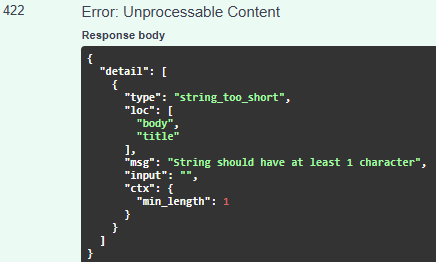

# Práctica 1.2 - Modelado con Pydantic

## Objetivo

Definir los schemas de entrada y salida de la API TaskFlow utilizando Pydantic, aplicando validaciones y exponiendo un endpoint temporal que permita comprobar el correcto funcionamiento de los modelos.

---

## Estructura añadida

Se ha creado el archivo:

```text
app/
└── schemas.py
```

Encargado de contener todos los modelos de datos (schemas) de la aplicación.

---

## Schemas implementados

### TaskCreate

Schema utilizado para recibir datos al crear una tarea.

Campos:

- `title: str`
- `description: str | None`
- `project_id: int`

Validación aplicada:

```python
title: str = Field(
    min_length=1,
    max_length=100
)
```

Restricciones:

- El título no puede estar vacío.
- El título no puede superar los 100 caracteres.

---

### TaskRead

Schema utilizado para devolver información de una tarea.

Campos:

- `id: int`
- `title: str`
- `description: str | None`
- `project_id: int`
- `completed: bool`
- `created_at: datetime`

---

### ProjectCreate

Schema utilizado para la creación de proyectos.

Campos:

- `name: str`
- `description: str`

---

### ProjectRead

Schema utilizado para devolver información de proyectos.

Campos:

- `id: int`
- `name: str`
- `description: str`
- `created_at: datetime`

---

## Endpoint temporal implementado

Se ha añadido el endpoint:

```http
POST /tasks
```

Configuración:

```python
@app.post(
    "/tasks",
    response_model=TaskRead,
    status_code=201
)
```

### Entrada

Recibe un objeto del tipo:

```json
{
  "title": "Primera tarea",
  "description": "Descripción de prueba",
  "project_id": 1
}
```

### Salida

Devuelve un objeto del tipo:

```json
{
  "id": 1,
  "title": "Primera tarea",
  "description": "Descripción de prueba",
  "project_id": 1,
  "completed": false,
  "created_at": "2026-11-03T15:00:00"
}
```

---

## Validación de datos

### Caso válido

Petición:

```json
{
  "title": "Caso de prueba",
  "description": "Descripción de prueba",
  "project_id": 1
}
```

Resultado:


---

### Caso inválido

Petición:

```json
{
  "title": "",
  "description": "Descripción de prueba",
  "project_id": 1
}
```

Resultado:



---

## Ejecución del proyecto

Activación del entorno virtual:

```bash
venv\Scripts\activate
```

Arranque del servidor:

```bash
python -m uvicorn app.main:app --reload
```

Acceso a la documentación Swagger:

```text
http://127.0.0.1:8000/docs
```

---

## Concepto de Schema

Un schema define el contrato de entrada y salida de la API.

Permite:

- Validar datos recibidos.
- Documentar automáticamente la API.
- Garantizar los tipos de datos.
- Generar modelos visibles en Swagger.

Los schemas no representan tablas de base de datos, sino la información que intercambia la API con los clientes.

---
